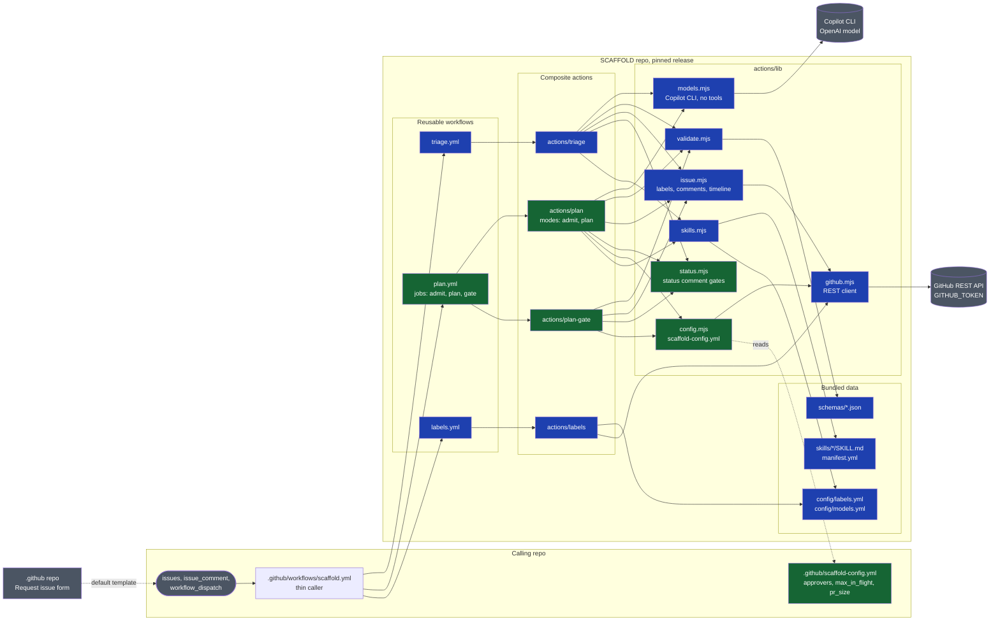

# SCAFFOLD architecture

Components and how they call each other (PLAN.md section 10). Updated in every slice's PR; hand-drawn until the `scaffold-diagrams` check generates it.

- **Calling repo:** a thin caller workflow and `.github/scaffold-config.yml`. The Request issue form comes from the `.github` repo.
- **SCAFFOLD repo:** reusable workflows call composite actions pinned to a release SHA; the actions bundle skills, schemas and config, so no cross-repo checkout is needed.
- **Model calls:** one tool-less Copilot CLI call per AI step. Actions code validates the JSON and makes every write with `GITHUB_TOKEN`.

As of: **slice 2**.

Fill shows the slice that added each component (blue: slice 1, green: slice 2; colours as in `workflow.md`); grey is outside SCAFFOLD.

## History

| Slice | Date | Change |
| --- | --- | --- |
| 2 | 2026-11-20 | Drawn: slice 1 triage and labels; slice 2 plan (admit and plan modes), plan gate, `scaffold-config.yml` config and status gates |
