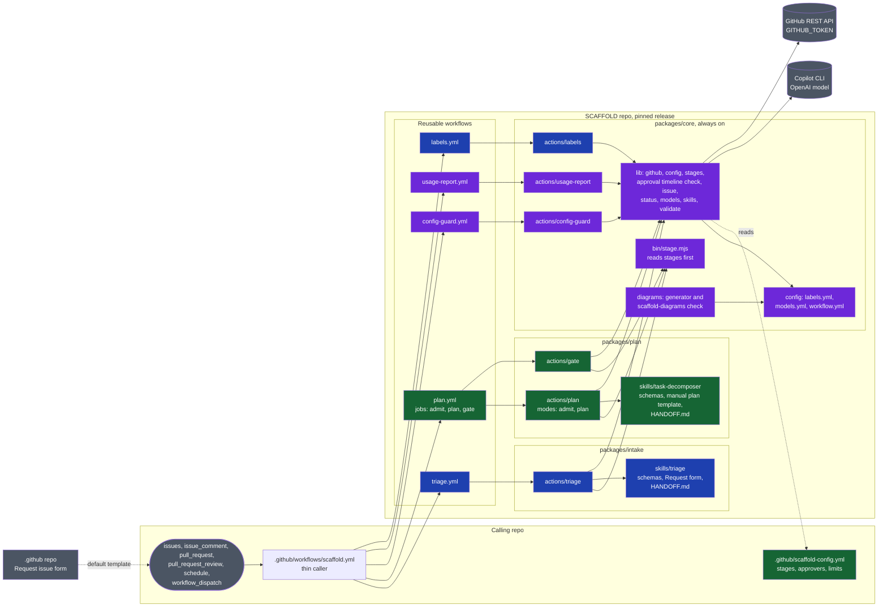
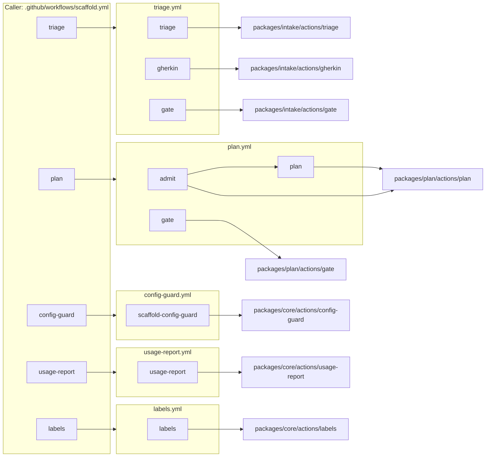

# SCAFFOLD architecture

Components and how they call each other (PLAN.md section 10). The components diagram is hand-drawn and updated in every slice's PR; the Actions graph below it is generated from `.github/workflows/*.yml` and the caller template, and the `scaffold-diagrams` check fails if it is stale.

- **Calling repo:** a thin caller workflow and `.github/scaffold-config.yml`, whose `stages` turns packages on or off. The Request issue form comes from the `.github` repo.
- **SCAFFOLD repo:** one reusable workflow per package calls that package's composite actions, pinned to a release SHA. Each package action reads `stages` first and does nothing else when its stage is off. Actions bundle their skills, schemas and config, so no cross-repo checkout is needed.
- **Packages:** `intake` and `plan` import only from `core` (a test fails on any other import) and hand over through labels and marked comments.
- **Model calls:** one tool-less Copilot CLI call per AI step. Actions code validates the JSON and makes every write with `GITHUB_TOKEN`.

As of: **Phase 1b**.

Fill shows when each component arrived (blue: slice 1, green: slice 2, purple: Phase 1b; slice colours as in `workflow.md`); grey is outside SCAFFOLD.

## Actions graph

Caller jobs, the reusable workflows they call, those workflows' jobs, and the package actions each job runs.

<!-- generated by `node packages/core/diagrams/check.mjs --write`: do not edit by hand -->

<!-- end of generated diagram -->

## History

| Slice | Date | Change |
| --- | --- | --- |
| 2 | 2026-11-20 | Drawn: slice 1 triage and labels; slice 2 plan (admit and plan modes), plan gate, `scaffold-config.yml` config and status gates |
| 1b | 2026-11-26 | Packages: `core`, `intake` and `plan`, each action reading `stages` first; timeline approval check moved to core; `scaffold-config-guard`, weekly usage report, `workflow.yml` and the generated Actions graph added |
