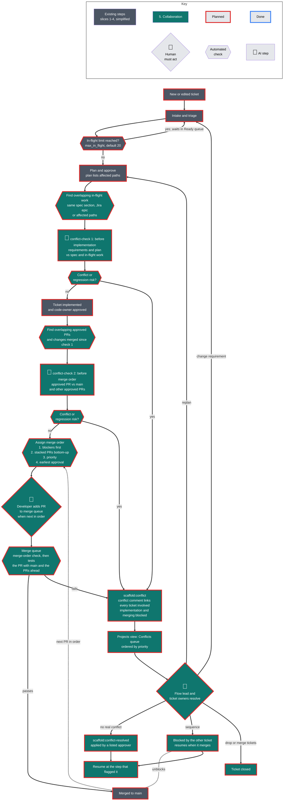

# SCAFFOLD collaboration workflow

How SCAFFOLD keeps several tickets in development at once from conflicting with each other or causing regressions (PLAN.md section 8). The development loops from `workflow.md` are collapsed into single grey steps.

- **Check twice:** `conflict-check` runs once before implementation starts (requirements and plan) and once after code-owner approval, before the PR is given a merge position.
- **Find:** before each check, Actions code shortlists overlapping work deterministically: same spec section, Jira epic or affected paths as other in-flight tickets, approved PRs and changes merged since the first check.
- **Judge:** the `conflict-check` skill decides whether each overlap is a real conflict or regression risk, and explains why.
- **Flag:** Actions applies `scaffold:conflict` and posts one conflict comment linking every ticket involved. Implementation and merging are blocked while the flag is open.
- **Queue:** the Projects "Conflicts" view lists flagged tickets by priority. The flow lead and the owners of the tickets involved resolve them.
- **Merge order:** Actions orders approved PRs: blockers first, stacked PRs bottom-up, then priority, then earliest approval. Developers add PRs to the merge queue in that order; a check fails if a PR jumps the order.

Same key as `workflow.md`, plus grey for existing steps.

## Proposed

## History

| Slice | Date | Change |
| --- | --- | --- |
| 0 | 2026-11-13 | Proposed collaboration workflow drawn |
