# SCAFFOLD workflow

Two diagrams, kept as code (PLAN.md section 10). How concurrent tickets are checked for conflicts is in `collaboration.md`.

- **Proposed:** the target lifecycle. Hand-maintained; a PR that changes it is a proposal to change the workflow.
- **Current:** the workflow as implemented. Updated at the end of every slice. Hand-drawn until `config/workflow.yml` and the `scaffold-diagrams` check land (outstanding from slice 1); then generated, and the check fails if it is stale.

## Proposed

Fill colour shows the slice that delivers each step; the border shows whether it is planned or done. The slice's PR switches its steps from `planned` to `done`.

Shape shows who moves the work on: a diamond with 🧑 needs a human to act; a hexagon is an automated check; 🤖 is an AI step; a plain box is a state or artefact. See the key at the top.

```mermaid
flowchart TD
  subgraph key[Key]
    direction LR
    k1[1. Intake]
    k2[2. Plan]
    k3[3. Implement]
    k4[4. Review]
    k5[5. Collaboration]
    kp[Planned]
    kd[Done]
    kh{"<span style='font-size:2em'>🧑</span><br/>Human<br/>must act"}
    ka{{Automated<br/>check}}
    kai["<span style='font-size:2em'>🤖</span> AI step"]
    k1 ~~~ k2 ~~~ k3 ~~~ k4 ~~~ k5
    kp ~~~ kd ~~~ kh ~~~ ka ~~~ kai
  end
  style key fill:#fff,stroke:#000
  key ~~~ jira

  jira[Jira requirement] --> open{"<span style='font-size:2em'>🧑</span><br/>Developer opens issue<br/>via Jira issue form"}
  open --> member{{Author is a trusted org<br/>member or collaborator?}}
  member -- no --> proposed[scaffold:proposed]
  proposed --> accept{"<span style='font-size:2em'>🧑</span><br/>Member applies<br/>scaffold:accepted"}
  accept --> triage
  member -- yes --> triage["<span style='font-size:2em'>🤖</span> triage"]
  triage --> needsinfo[scaffold:needs-info]
  needsinfo --> edit{"<span style='font-size:2em'>🧑</span><br/>Author edits issue,<br/>applies scaffold:triage"}
  edit --> triage
  triage --> ready[scaffold:ready<br/>Projects: Ready]

  ready --> plancmd{"<span style='font-size:2em'>🧑</span><br/>Member<br/>comments /plan"}
  plancmd --> limit{{In-flight limit reached?<br/>max_in_flight, default 20}}
  limit -- yes: waits in Ready --> ready
  limit -- no --> decompose["<span style='font-size:2em'>🤖</span> task-decomposer"]
  decompose --> plansize{{Estimated size over soft limit?<br/>10 files or 1000 lines}}
  plansize -- no --> plancomment[Plan comment<br/>scaffold:planned]
  plansize -- yes --> split["<span style='font-size:2em'>🤖</span> task-decomposer splits work<br/>into a stack of PRs or up to 5 sub-tickets"]
  split --> plancomment
  split -- needs more than 5 sub-tickets --> planreview
  plancomment --> planreview{"<span style='font-size:2em'>🧑</span><br/>Approver<br/>reviews plan"}
  planreview -- changes needed --> plancmd
  planreview -- approves --> approved[scaffold:plan-approved<br/>gate: listed approver, not the author,<br/>plan unchanged since approval]
  approved -- gate fails: label removed --> planreview

  approved --> check1["<span style='font-size:2em'>🤖</span> conflict-check 1<br/>before implementation:<br/>vs spec and in-flight work"]
  check1 -- conflict --> conflicts1[scaffold:conflict<br/>Conflicts queue for human review<br/>see collaboration.md]
  check1 -- no conflict --> assign{"<span style='font-size:2em'>🧑</span><br/>Developer assigns<br/>issue to Copilot"}
  assign --> copilot["<span style='font-size:2em'>🤖</span> Copilot coding agent<br/>tdd, implement"]
  copilot --> pr[Copilot PR]
  pr --> guards{{Guard checks<br/>plan gate, protected paths, test integrity}}
  pr --> prsize{{PR size check<br/>soft: 10 files / 1000 lines<br/>hard: 30 files / 5000 lines<br/>exempt files excluded}}
  prsize -- within soft limit --> readygate
  prsize -- over soft, within hard --> sizecmd{"<span style='font-size:2em'>🧑</span><br/>Developer may comment<br/>/size-exception reason"}
  prsize -- over hard --> breaker{{Circuit breaker<br/>6 rework rounds used?}}
  sizecmd --> sizeexc{"<span style='font-size:2em'>🧑</span><br/>Listed approver decides<br/>scaffold:size-exception"}
  sizeexc -- accepted --> readygate
  pr --> ci{{CI}}
  pr --> review["<span style='font-size:2em'>🤖</span> code-review"]
  ci -- fails --> diagnose["<span style='font-size:2em'>🤖</span> ci-diagnose"]
  guards --> readygate
  ci -- passes --> readygate
  diagnose --> readygate
  review --> readygate{{Ready for human review?<br/>guard checks pass, CI passes,<br/>all code-review comments resolved,<br/>within soft size limit or exception}}
  readygate -- no --> breaker{{Circuit breaker<br/>6 rework rounds used?}}
  breaker -- no --> rework[Automatic rework round<br/>Actions asks @copilot to fix checks, resolve comments<br/>and split oversized work into stacked PRs;<br/>no human approval]
  rework --> copilot
  breaker -- yes --> escalate[scaffold:escalate<br/>circuit breaker tripped;<br/>size exception requested if oversized]
  escalate --> ownerreview
  readygate -- yes --> ownerreview{"<span style='font-size:2em'>🧑</span><br/>Code-owner<br/>review"}
  ownerreview -- changes requested --> copilot
  ownerreview -- needs replanning --> ready
  ownerreview -- approves --> check2["<span style='font-size:2em'>🤖</span> conflict-check 2<br/>before merge order:<br/>vs main and approved PRs"]
  check2 -- conflict --> conflicts2[scaffold:conflict<br/>Conflicts queue for human review<br/>see collaboration.md]
  check2 -- no conflict --> order{{Assign merge order<br/>blockers, stacks, priority,<br/>approval time}}
  order --> merge{"<span style='font-size:2em'>🧑</span><br/>Developer adds PR<br/>to merge queue<br/>when next in order"}
  merge --> mq{{Merge queue<br/>merge-order check, then tests<br/>with main and PRs ahead}}
  mq -- fails --> mainonly{{Fails with just main?}}
  mainonly -- yes: automatic rework --> breaker
  mainonly -- no --> conflicts2
  mq -- passes --> closed[Merged, issue closed<br/>Projects: Done]
  conflicts2 ~~~ closed


  linkStyle default stroke-width:3px

  classDef s1 fill:#1e40af,color:#fff
  classDef s2 fill:#166534,color:#fff
  classDef s3 fill:#a16207,color:#fff
  classDef s4 fill:#9d174d,color:#fff
  classDef s5 fill:#0f766e,color:#fff
  classDef planned stroke:#dc2626,stroke-width:4px
  classDef done stroke:#3b82f6,stroke-width:4px
  classDef legend fill:#e5e7eb,color:#000

  class k1 s1
  class k2 s2
  class k3 s3
  class k4 s4
  class k5 s5
  class kp,kd,kh,ka,kai legend
  class kp planned
  class kd done

  class jira,open,member,proposed,accept,triage,needsinfo,edit,ready s1
  class plancmd,limit,decompose,plansize,split,plancomment,planreview,approved s2
  class assign,copilot,pr,guards,rework,breaker,escalate,sizeexc,sizecmd,prsize,ownerreview,closed s3
  class ci,review,diagnose,readygate s4
  class check1,check2,conflicts1,conflicts2,order,merge,mq,mainonly s5

  class jira,ready planned
  class open,member,proposed,accept,triage,needsinfo,edit done
  class plancmd,limit,decompose,plansize,split,plancomment,planreview,approved done
  class assign,copilot,pr,guards,rework,breaker,escalate,sizeexc,sizecmd,prsize,ownerreview,closed planned
  class ci,review,diagnose,readygate planned
  class check1,check2,conflicts1,conflicts2,order,merge,mq,mainonly planned
```

Visibility is part of every slice rather than a stage of its own: each slice adds its steps to the status comment, audit log, usage report and these diagrams (PLAN.md section 11).

## Current

As of: **slice 2**. SCAFFOLD runs intake, triage and planning (blue); implementation onwards is still manual (grey). `Projects: Ready` and the Jira link are not built yet.

```mermaid
flowchart TD
  subgraph key[Key]
    direction LR
    ks[SCAFFOLD]
    km[Manual]
    kh{"<span style='font-size:2em'>🧑</span><br/>Human<br/>must act"}
    ka{{Automated<br/>check}}
    kai["<span style='font-size:2em'>🤖</span> AI step"]
    ks ~~~ km ~~~ kh ~~~ ka ~~~ kai
  end
  style key fill:#fff,stroke:#000
  key ~~~ jira

  jira[Jira ticket created] --> open{"<span style='font-size:2em'>🧑</span><br/>Developer opens issue<br/>via Request form"}
  open --> member{{Author is a trusted org<br/>member or collaborator?}}
  member -- no --> proposed[scaffold:proposed]
  proposed --> accept{"<span style='font-size:2em'>🧑</span><br/>Member applies<br/>scaffold:accepted"}
  accept --> triage
  member -- yes --> triage["<span style='font-size:2em'>🤖</span> triage<br/>flags scaffold:no-template"]
  triage --> needsinfo[scaffold:needs-info]
  needsinfo --> edit{"<span style='font-size:2em'>🧑</span><br/>Author edits issue,<br/>applies scaffold:triage"}
  edit --> triage
  triage --> ready[scaffold:ready]

  ready --> plancmd{"<span style='font-size:2em'>🧑</span><br/>Member<br/>comments /plan"}
  plancmd --> limit{{Admit, one at a time per repo:<br/>in-flight limit reached?<br/>max_in_flight in scaffold-config.yml<br/>also sweeps up dropped /plan runs}}
  limit -- yes, or scaffold-config.yml invalid:<br/>waits --> ready
  limit -- no: reserves slot,<br/>scaffold:planned --> decompose["<span style='font-size:2em'>🤖</span> task-decomposer<br/>estimate, split into stack<br/>or up to 5 sub-tickets"]
  decompose -- fails on a first plan:<br/>slot released --> ready
  decompose --> plansize{{Plan breaks size rules?}}
  plansize -- yes, first time --> decompose
  plansize -- no --> plancomment[Plan comment<br/>scaffold:planned]
  plansize -- yes again: can't be approved --> plancomment
  plancomment --> planreview{"<span style='font-size:2em'>🧑</span><br/>Approver<br/>reviews plan"}
  planreview -- changes needed --> plancmd
  planreview -- applies scaffold:plan-approved --> gate{{Plan gate<br/>listed approver, not the author,<br/>plan unchanged, size rules}}
  gate -- fails, or sub-tickets not all created:<br/>label removed --> planreview
  gate -- passes --> approved[scaffold:plan-approved<br/>sub-tickets created as sub-issues]
  plancomment -- plan comment deleted<br/>or its marker removed:<br/>approval withdrawn --> ready
  approved -- plan comment edited:<br/>approval removed --> planreview

  approved --> pick{"<span style='font-size:2em'>🧑</span><br/>Developer picks up ticket"}
  pick --> code[Developer writes code]
  code --> pr[PR]
  pr --> ci{{CI}}
  ci -- fails --> code
  ci -- passes --> review{"<span style='font-size:2em'>🧑</span><br/>Peer review"}
  review -- changes requested --> code
  review -- approves --> test{"<span style='font-size:2em'>🧑</span><br/>Ticket tested"}
  test -- fails: changes requested --> code
  test -- passes --> merge[Developer merges]
  merge --> closed[Issue and Jira ticket closed]

  linkStyle default stroke-width:3px

  classDef scaffold fill:#1e40af,color:#fff
  classDef manual fill:#4b5563,color:#fff

  class ks scaffold
  class km manual
  class kh,ka,kai scaffold

  class open,member,proposed,accept,triage,needsinfo,edit,ready,plancmd,limit,decompose,plansize,plancomment,planreview,gate,approved scaffold
  class jira,pick,code,pr,ci,review,test,merge,closed manual
```

## History

One row per slice, added in the slice's retrospective PR. Earlier versions of both diagrams are in git history.

| Slice | Date | Change |
| --- | --- | --- |
| 0 | 2026-11-13 | Proposed workflow drawn; current workflow assumed manual |
| 1 | 2026-11-18 | Intake: Request form, members-only `triage`, `scaffold:needs-info` loop re-run by `scaffold:triage`, `scaffold:no-template` flag, status comment. Diagrams updated in slice 2's PR |
| 2 | 2026-11-20 | Plan: `/plan`, in-flight limit (repo-wide admission with a sweep for dropped runs; a failed first plan gives its slot back), `task-decomposer` with size estimate and split, `scaffold:planned`, protected plan gate, sub-tickets as sub-issues on approval (approval withheld until all exist); deleting the plan comment or removing its marker sends the issue back to Ready, and any other edit to it removes the approval; plans with no sub-tasks are rejected; an invalid `scaffold-config.yml` blocks planning and approval. Proposed: needs-info edit step applies `scaffold:triage`; plan comment sets `scaffold:planned`; gate-fail edge |
