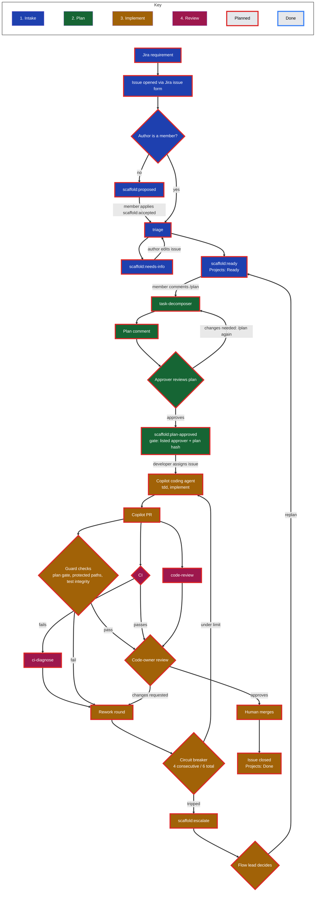
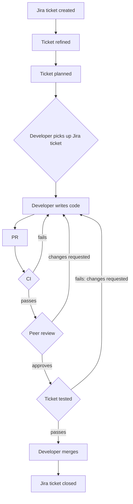

# SCAFFOLD workflow

Two diagrams, kept as code (PLAN.md section 10):

- **Proposed:** the target lifecycle. Hand-maintained; a PR that changes it is a proposal to change the workflow.
- **Current:** the workflow as implemented. Updated at the end of every slice; from slice 1 it is generated from `config/workflow.yml` and the `scaffold-diagrams` check fails if it is stale.

## Proposed

Fill colour shows the slice that delivers each step; the border shows whether it is planned or done (see the key at the top). The slice's PR switches its steps from `planned` to `done`.

Shapes: `{ }` human decision or gate, `[ ]` step, state or artefact.

Visibility is part of every slice rather than a stage of its own: each slice adds its steps to the status comment, audit log, usage report and these diagrams (PLAN.md section 11).

## Current

As of: **before slice 1**. Assumed manual workflow; confirm with the pilot developers in Phase 0.

## History

One row per slice, added in the slice's retrospective PR. Earlier versions of both diagrams are in git history.

| Slice | Date | Change |
| --- | --- | --- |
| 0 | 2026-11-13 | Proposed workflow drawn; current workflow assumed manual |
