# SCAFFOLD workflow

Two diagrams, kept as code (PLAN.md section 10). How concurrent tickets are checked for conflicts is in `collaboration.md`.

- **Proposed:** the target lifecycle. Hand-maintained; a PR that changes it is a proposal to change the workflow.
- **Current:** the workflow as implemented. Generated from `packages/core/config/workflow.yml` (`npm run diagrams`); the `scaffold-diagrams` check in self-test fails if it is stale or `workflow.yml` disagrees with the code. Updated in every slice's PR.

## Proposed

Fill colour shows the slice that delivers each step; the border shows whether it is planned or done. The slice's PR switches its steps from `planned` to `done`.

Shape shows who moves the work on: a diamond with 🧑 needs a human to act; a hexagon is an automated check; 🤖 is an AI step; a plain box is a state or artefact. See the key at the top.

```mermaid
flowchart TD
  subgraph key[Key]
    direction LR
    k1[1. Intake]
    k2[2. Plan]
    k3[3. Implement]
    k4[4. Review]
    k5[5. Collaboration]
    kp[Planned]
    kd[Done]
    kh{"<span style='font-size:2em'>🧑</span><br/>Human<br/>must act"}
    ka{{Automated<br/>check}}
    kai["<span style='font-size:2em'>🤖</span> AI step"]
    k1 ~~~ k2 ~~~ k3 ~~~ k4 ~~~ k5
    kp ~~~ kd ~~~ kh ~~~ ka ~~~ kai
  end
  style key fill:#fff,stroke:#000
  key ~~~ jira

  jira[Jira requirement] --> open{"<span style='font-size:2em'>🧑</span><br/>Developer opens issue<br/>via Jira issue form"}
  open --> member{{Author is a trusted org<br/>member or collaborator?}}
  member -- no --> proposed[scaffold:proposed]
  proposed --> accept{"<span style='font-size:2em'>🧑</span><br/>Member applies<br/>scaffold:accepted"}
  accept --> triage
  member -- yes --> triage["<span style='font-size:2em'>🤖</span> triage"]
  triage --> needsinfo[scaffold:needs-info]
  needsinfo --> edit{"<span style='font-size:2em'>🧑</span><br/>Author edits issue,<br/>applies scaffold:triage"}
  edit --> triage
  triage --> ready[scaffold:ready<br/>Projects: Ready]
  triage -- scenarios needed --> gherkinwriter["<span style='font-size:2em'>🤖</span> gherkin-writer<br/>drafts unless the form gave them"]
  gherkinwriter --> needsgherkin[Scenarios comment<br/>scaffold:needs-gherkin]
  needsgherkin --> gherkinreview{"<span style='font-size:2em'>🧑</span><br/>Approver reviews<br/>scenarios"}
  gherkinreview -- /gherkin: redraft --> gherkinwriter
  gherkinreview -- approves --> gherkinapproved[scaffold:gherkin-approved<br/>gate: listed approver, not the author,<br/>scenarios unchanged, Gherkin parses]
  gherkinapproved -- gate fails: label removed --> gherkinreview
  gherkinapproved --> ready

  ready --> plancmd{"<span style='font-size:2em'>🧑</span><br/>Member<br/>comments /plan"}
  plancmd --> limit{{In-flight limit reached?<br/>max_in_flight, default 20}}
  limit -- yes: waits in Ready --> ready
  limit -- no --> decompose["<span style='font-size:2em'>🤖</span> task-decomposer<br/>maps each approved scenario to a PR"]
  decompose --> plansize{{Estimated size over soft limit?<br/>10 files or 1000 lines}}
  plansize -- no --> plancomment[Plan comment<br/>scaffold:planned]
  plansize -- yes --> split["<span style='font-size:2em'>🤖</span> task-decomposer splits work<br/>into a stack of up to max_stack_prs PRs,<br/>default 5"]
  split --> plancomment
  split -- needs more than max_stack_prs PRs --> toobig[scaffold:too-big<br/>back to triage, which<br/>proposes smaller tickets]
  toobig --> triage
  plancomment --> planreview{"<span style='font-size:2em'>🧑</span><br/>Approver<br/>reviews plan"}
  planreview -- changes needed --> plancmd
  planreview -- approves --> approved[scaffold:plan-approved<br/>gate: listed approver, not the author,<br/>plan unchanged since approval]
  approved -- gate fails: label removed --> planreview

  approved --> check1["<span style='font-size:2em'>🤖</span> conflict-check 1<br/>before implementation:<br/>vs spec and in-flight work"]
  check1 -- conflict --> conflicts1[scaffold:conflict<br/>Conflicts queue for human review<br/>see collaboration.md]
  check1 -- no conflict --> assign{"<span style='font-size:2em'>🧑</span><br/>Developer assigns<br/>issue to Copilot"}
  assign --> copilot["<span style='font-size:2em'>🤖</span> Copilot coding agent<br/>tdd, implement"]
  copilot --> pr[Copilot PR]
  pr --> guards{{Guard checks<br/>plan gate, protected paths, test integrity}}
  pr --> prsize{{PR size check<br/>soft: 10 files / 1000 lines<br/>hard: 30 files / 5000 lines<br/>exempt files excluded}}
  prsize -- within soft limit --> readygate
  prsize -- over soft, within hard --> sizecmd{"<span style='font-size:2em'>🧑</span><br/>Developer may comment<br/>/size-exception reason"}
  prsize -- over hard --> breaker{{Circuit breaker<br/>6 rework rounds used?}}
  sizecmd --> sizeexc{"<span style='font-size:2em'>🧑</span><br/>Listed approver decides<br/>scaffold:size-exception"}
  sizeexc -- accepted --> readygate
  pr --> ci{{CI}}
  pr --> review["<span style='font-size:2em'>🤖</span> code-review"]
  ci -- fails --> diagnose["<span style='font-size:2em'>🤖</span> ci-diagnose"]
  guards --> readygate
  ci -- passes --> readygate
  diagnose --> readygate
  review --> readygate{{Ready for human review?<br/>guard checks pass, CI passes,<br/>all code-review comments resolved,<br/>within soft size limit or exception}}
  readygate -- no --> breaker{{Circuit breaker<br/>6 rework rounds used?}}
  breaker -- no --> rework[Automatic rework round<br/>Actions asks @copilot to fix checks, resolve comments<br/>and split oversized work into stacked PRs;<br/>no human approval]
  rework --> copilot
  breaker -- yes --> escalate[scaffold:escalate<br/>circuit breaker tripped;<br/>size exception requested if oversized]
  escalate --> ownerreview
  readygate -- yes --> ownerreview{"<span style='font-size:2em'>🧑</span><br/>Code-owner<br/>review"}
  ownerreview -- changes requested --> copilot
  ownerreview -- needs replanning --> ready
  ownerreview -- approves --> check2["<span style='font-size:2em'>🤖</span> conflict-check 2<br/>before merge order:<br/>vs main and approved PRs"]
  check2 -- conflict --> conflicts2[scaffold:conflict<br/>Conflicts queue for human review<br/>see collaboration.md]
  check2 -- no conflict --> order{{Assign merge order<br/>blockers, stacks, priority,<br/>approval time}}
  order --> merge{"<span style='font-size:2em'>🧑</span><br/>Developer adds PR<br/>to merge queue<br/>when next in order"}
  merge --> mq{{Merge queue<br/>merge-order check, then tests<br/>with main and PRs ahead}}
  mq -- fails --> mainonly{{Fails with just main?}}
  mainonly -- yes: automatic rework --> breaker
  mainonly -- no --> conflicts2
  mq -- passes --> closed[Merged, issue closed<br/>Projects: Done]
  conflicts2 ~~~ closed


  linkStyle default stroke-width:3px

  classDef s1 fill:#1e40af,color:#fff
  classDef s2 fill:#166534,color:#fff
  classDef s3 fill:#a16207,color:#fff
  classDef s4 fill:#9d174d,color:#fff
  classDef s5 fill:#0f766e,color:#fff
  classDef planned stroke:#dc2626,stroke-width:4px
  classDef done stroke:#3b82f6,stroke-width:4px
  classDef legend fill:#e5e7eb,color:#000

  class k1 s1
  class k2 s2
  class k3 s3
  class k4 s4
  class k5 s5
  class kp,kd,kh,ka,kai legend
  class kp planned
  class kd done

  class jira,open,member,proposed,accept,triage,needsinfo,edit,ready,gherkinwriter,needsgherkin,gherkinreview,gherkinapproved s1
  class plancmd,limit,decompose,plansize,split,toobig,plancomment,planreview,approved s2
  class assign,copilot,pr,guards,rework,breaker,escalate,sizeexc,sizecmd,prsize,ownerreview,closed s3
  class ci,review,diagnose,readygate s4
  class check1,check2,conflicts1,conflicts2,order,merge,mq,mainonly s5

  class jira,ready planned
  class open,member,proposed,accept,triage,needsinfo,edit,gherkinwriter,needsgherkin,gherkinreview,gherkinapproved done
  class plancmd,limit,decompose,plansize,split,toobig,plancomment,planreview,approved done
  class assign,copilot,pr,guards,rework,breaker,escalate,sizeexc,sizecmd,prsize done
  class ownerreview,closed planned
  class ci,review,diagnose,readygate planned
  class check1,check2,conflicts1,conflicts2,order,merge,mq,mainonly planned
```

Visibility is part of every slice rather than a stage of its own: each slice adds its steps to the status comment, audit log, usage report and these diagrams (PLAN.md section 11).

## Current

As of: **Phase 1b**. SCAFFOLD runs the intake and plan packages (blue) when `stages` in `scaffold-config.yml` turns them on; a package that is off is done by hand from its `HANDOFF.md` (grey). Implementation onwards is still manual. `Projects: Ready` and the Jira link are not built yet.

```mermaid
flowchart TD
  subgraph key[Key]
    direction LR
    ks[SCAFFOLD]
    km[Manual]
    kh{"<span style='font-size:2em'>🧑</span><br/>Human<br/>must act"}
    ka{{"Automated<br/>check"}}
    kai["<span style='font-size:2em'>🤖</span> AI step"]
    ks ~~~ km ~~~ kh ~~~ ka ~~~ kai
  end
  style key fill:#fff,stroke:#000
  key ~~~ jira

  jira["Jira ticket created"]
  open{"<span style='font-size:2em'>🧑</span><br/>Developer opens issue<br/>via Request form"}
  intakeon{{"intake stage on?<br/>stages in scaffold-config.yml"}}
  manualtriage{"<span style='font-size:2em'>🧑</span><br/>Humans triage by hand<br/>packages/intake/HANDOFF.md"}
  member{{"Author is a trusted org<br/>member or collaborator?"}}
  proposed["scaffold:proposed"]
  accept{"<span style='font-size:2em'>🧑</span><br/>Member applies<br/>scaffold:accepted"}
  triage["<span style='font-size:2em'>🤖</span> triage<br/>flags scaffold:no-template"]
  needsinfo["scaffold:needs-info"]
  edit{"<span style='font-size:2em'>🧑</span><br/>Author edits issue,<br/>applies scaffold:triage"}
  gherkinwriter["<span style='font-size:2em'>🤖</span> gherkin-writer<br/>drafts scenarios unless the form<br/>or a scenarios comment gave them"]
  needsgherkin["Scenarios comment, S1..Sn<br/>scaffold:needs-gherkin"]
  gherkinreview{"<span style='font-size:2em'>🧑</span><br/>Approver<br/>reviews scenarios"}
  scengate{{"Scenarios gate<br/>core timeline check: listed approver,<br/>not the author, scenarios unchanged;<br/>Gherkin parses, tagged S1..Sn"}}
  ready["scaffold:ready"]
  split{"<span style='font-size:2em'>🧑</span><br/>Member creates the proposed<br/>tickets as new issues,<br/>closes this one as split"}
  planon{{"plan stage on?<br/>stages in scaffold-config.yml"}}
  manualplan{"<span style='font-size:2em'>🧑</span><br/>Humans plan by hand<br/>packages/plan/HANDOFF.md:<br/>scaffold:planned, manual plan template,<br/>approver applies scaffold:plan-approved"}
  plancmd{"<span style='font-size:2em'>🧑</span><br/>Member<br/>comments /plan"}
  limit{{"Admit, one at a time per repo:<br/>required scenarios not approved, or<br/>in-flight limit reached?<br/>max_in_flight in scaffold-config.yml<br/>also sweeps up dropped /plan runs"}}
  decompose["<span style='font-size:2em'>🤖</span> task-decomposer<br/>estimate; one PR, or a stack<br/>of up to max_stack_prs PRs;<br/>maps each approved scenario to a PR"]
  plansize{{"Plan breaks size rules,<br/>or leaves a scenario unmapped?"}}
  toobig["scaffold:too-big<br/>leaves flight"]
  retriage{"<span style='font-size:2em'>🧑</span><br/>Member applies<br/>scaffold:triage"}
  plancomment["Plan comment<br/>scaffold:planned"]
  planreview{"<span style='font-size:2em'>🧑</span><br/>Approver<br/>reviews plan"}
  gate{{"Plan gate<br/>core timeline check: listed approver,<br/>not the author, plan unchanged;<br/>size rules, max_stack_prs;<br/>scenarios still approved and unchanged,<br/>each mapped"}}
  approved["scaffold:plan-approved"]
  implon{{"implement stage on?<br/>stages in scaffold-config.yml"}}
  pick{"<span style='font-size:2em'>🧑</span><br/>Developer picks up ticket<br/>packages/implement/HANDOFF.md"}
  code["Developer writes code"]
  assign{"<span style='font-size:2em'>🧑</span><br/>Developer assigns<br/>issue to Copilot"}
  copilot["<span style='font-size:2em'>🤖</span> Copilot coding agent<br/>tdd, implement skills;<br/>a stack of PRs if planned"]
  pr["PR, Fixes"]
  baseline{{"Core baseline checks, every PR:<br/>protected paths, hard size limit,<br/>test integrity, scenarios<br/>with the BDD runner report"}}
  implchecks{{"Plan gate re-checks the approval;<br/>PR size within the soft limit<br/>or scaffold:size-exception"}}
  sizecmd{"<span style='font-size:2em'>🧑</span><br/>Developer comments /size-exception reason;<br/>listed approver applies<br/>scaffold:size-exception"}
  reviewgate{{"Review gate<br/>waits for every check<br/>on the head commit"}}
  rework["Automatic rework round<br/>@copilot comment lists the failures;<br/>no human approval"]
  escalate["scaffold:escalate<br/>circuit breaker:<br/>max_rework_rounds used"]
  ci{{"CI"}}
  review{"<span style='font-size:2em'>🧑</span><br/>Peer review"}
  test{"<span style='font-size:2em'>🧑</span><br/>Ticket tested"}
  merge["Developer merges"]
  closed["Issue and Jira ticket closed"]

  jira --> open
  open --> intakeon
  intakeon -- no --> manualtriage
  manualtriage --> ready
  intakeon -- yes --> member
  member -- no --> proposed
  proposed --> accept
  accept --> triage
  member -- yes --> triage
  triage --> needsinfo
  needsinfo --> edit
  edit --> triage
  triage --> ready
  triage -- scenarios needed:<br/>gherkin always, or auto<br/>and triage decides --> gherkinwriter
  gherkinwriter --> needsgherkin
  needsgherkin --> gherkinreview
  gherkinreview -- member comments /gherkin:<br/>redraft --> gherkinwriter
  gherkinreview -- applies scaffold:gherkin-approved --> scengate
  scengate -- fails: label removed --> gherkinreview
  scengate -- passes --> ready
  ready -- scenarios edited or redrafted:<br/>approvals withdrawn --> needsgherkin
  triage -- too big:<br/>proposes smaller tickets --> split
  split --> open
  ready --> planon
  planon -- no --> manualplan
  manualplan --> pick
  planon -- yes --> plancmd
  plancmd --> limit
  limit -- yes, or scaffold-config.yml invalid:<br/>waits --> ready
  limit -- no: reserves slot,<br/>scaffold:planned --> decompose
  decompose -- fails on a first plan:<br/>slot released --> ready
  decompose --> plansize
  plansize -- yes, first time --> decompose
  plansize -- no --> plancomment
  plansize -- yes again: can't be approved --> plancomment
  plansize -- needs more than<br/>max_stack_prs PRs --> toobig
  toobig --> retriage
  retriage --> triage
  plancomment --> planreview
  planreview -- changes needed --> plancmd
  planreview -- applies scaffold:plan-approved --> gate
  gate -- fails: label removed --> planreview
  gate -- passes --> approved
  plancomment -- plan comment deleted<br/>or its marker removed:<br/>approval withdrawn --> ready
  approved -- plan comment edited:<br/>approval removed --> planreview
  approved --> implon
  implon -- no --> pick
  pick --> code
  code --> pr
  implon -- yes --> assign
  assign --> copilot
  copilot --> pr
  pr --> baseline
  pr --> ci
  pr --> implchecks
  implchecks -- over the soft limit --> sizecmd
  sizecmd --> implchecks
  baseline --> reviewgate
  ci --> reviewgate
  implchecks --> reviewgate
  reviewgate -- fails on a Copilot PR,<br/>rounds left --> rework
  rework --> copilot
  reviewgate -- fails on a human's PR --> code
  reviewgate -- fails,<br/>max_rework_rounds used --> escalate
  escalate --> review
  reviewgate -- passes:<br/>review requested --> review
  review -- changes requested --> code
  review -- approves --> test
  test -- fails: changes requested --> code
  test -- passes --> merge
  merge --> closed

  linkStyle default stroke-width:3px

  classDef scaffold fill:#1e40af,color:#fff
  classDef manual fill:#4b5563,color:#fff
  class ks,kh,ka,kai scaffold
  class km manual
  class intakeon,member,proposed,accept,triage,needsinfo,edit,gherkinwriter,needsgherkin,gherkinreview,scengate,ready,planon,plancmd,limit,decompose,plansize,toobig,retriage,plancomment,planreview,gate,approved,implon,assign,copilot,pr,baseline,implchecks,sizecmd,reviewgate,rework,escalate scaffold
  class jira,open,manualtriage,split,manualplan,pick,code,ci,review,test,merge,closed manual
```

<!-- generated by `node packages/core/diagrams/check.mjs --write`: do not edit by hand -->

<!-- end of generated diagram -->

## History

One row per slice, added in the slice's retrospective PR. Earlier versions of both diagrams are in git history.

| Slice | Date | Change |
| --- | --- | --- |
| 0 | 2026-11-13 | Proposed workflow drawn; current workflow assumed manual |
| 1 | 2026-11-18 | Intake: Request form, members-only `triage`, `scaffold:needs-info` loop re-run by `scaffold:triage`, `scaffold:no-template` flag, status comment. Diagrams updated in slice 2's PR |
| 2 | 2026-11-20 | Plan: `/plan`, in-flight limit (repo-wide admission with a sweep for dropped runs; a failed first plan gives its slot back), `task-decomposer` with size estimate and split, `scaffold:planned`, protected plan gate, sub-tickets as sub-issues on approval (approval withheld until all exist); deleting the plan comment or removing its marker sends the issue back to Ready, and any other edit to it removes the approval; plans with no sub-tasks are rejected; an invalid `scaffold-config.yml` blocks planning and approval. Proposed: needs-info edit step applies `scaffold:triage`; plan comment sets `scaffold:planned`; gate-fail edge |
| 1b | 2026-11-26 | Packages: intake and plan switched by `stages` (off means manual, from each package's `HANDOFF.md`); sub-tickets dropped: a plan is one PR or a stack of up to `max_stack_prs`, and bigger work gets `scaffold:too-big`, leaves flight and goes back to triage, which proposes smaller tickets for a member to create. Current diagram now generated from `workflow.yml`. Proposed: stack of up to `max_stack_prs` PRs and the too-big route replace up to 5 sub-tickets |
| 2b | 2026-11-27 | Scenarios, in the intake package: `gherkin` config (`off`, `auto`, `always`; `bdd` required unless off), Request form Gherkin field, triage routes to `scaffold:needs-gherkin`, `gherkin-writer` drafts in the same run or on `/gherkin`, marked scenarios comment numbered S1..Sn, protected scenarios gate; edits and redrafts withdraw approvals. Plan re-checks the approval and maps each scenario to a PR; the plan gate fails if the scenarios changed. Proposed: scenarios steps added to intake, marked done |
| 3 | 2026-11-27 | Implement: core baseline PR checks on every PR (protected paths with the caller pin-bump exception, hard size limit, test integrity lifted by `scaffold:test-change-approved`, scenarios check reading the BDD runner report); implement package switched by `stages`: plan gate re-check, PR size with `/size-exception` and `scaffold:size-exception`, review gate waiting for every check, automatic `@copilot` rework rounds, circuit breaker with `scaffold:escalate`, advisory work in progress; PR status comment. Proposed: implement steps marked done; the review gate stays planned until slice 4 adds `code-review` threads |
